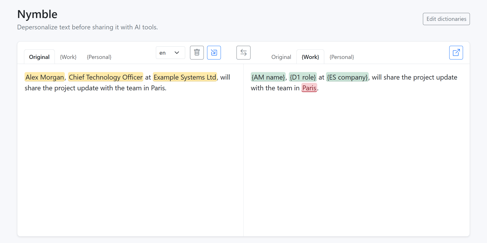
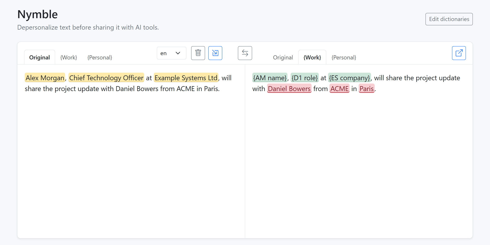
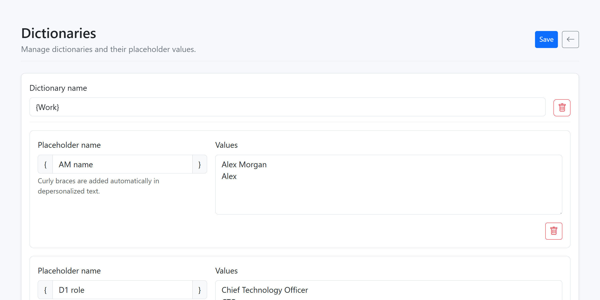
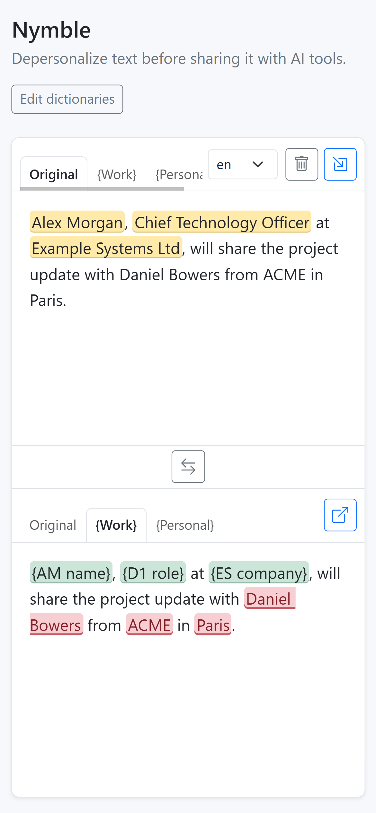

# Nymble

Nymble is a self-hosted web app that replaces sensitive details in text with
simple placeholders before you share it with AI, then restores them later.
After replacement, it uses Presidio to highlight possible leaks.

Nymble does not send text to an AI service. You remain in control of where the
depersonalized result is copied and which AI tool receives it.



## What it does

Nymble uses dictionaries that map semantic placeholders to one or more real
values:

```text
John Smith    -> {CEO}
Acme Ltd      -> {T company}
```

The first value is the primary value used when restoring placeholders. Other
values act as aliases during depersonalization.

```text
real text
  -> dictionary replacement
  -> depersonalized text
  -> Presidio analysis
  -> visual leak highlights
```

Presidio findings are visual only: Nymble does not automatically remove or
replace them. The copied result remains clean text without highlight markup.

## Using Nymble

1. Open **Edit dictionaries** and create placeholders for people, companies,
   projects, addresses, or any other values you do not want to share.
2. Return to the composer and choose a dictionary as the destination.
3. Paste or type the original text in the left editor.
4. Select the Presidio analysis language, or select `off` to skip leak
   detection for that transform.
5. Review the depersonalized result. Possible leaks are highlighted in red.
6. Copy the clean result and send it to the AI tool of your choice.
7. Paste the AI response into Nymble, reverse the direction, and restore the
   placeholders to their primary dictionary values.

The dictionary editor opens in a separate window so the composer text remains
in place. Saving dictionary changes refreshes the composer dictionaries and
automatically repeats the current transformation.

On a new installation, the bundled **{Work}** dictionary is selected and the
source editor shows one fictional sentence that demonstrates depersonalization.
It intentionally leaves `Paris` out of the dictionary so Presidio can
demonstrate a possible leak highlight. The example is intended for a first look
and screenshots. Clearing or changing the text, or changing the transformation
direction, records a browser cookie so the example is not shown again.

### Clipboard support

The source editor has a **Paste** button and the result editor has a **Copy**
button. Clipboard access depends on browser permission and requires a secure
context: use HTTPS in production, or `localhost` during local development.
Keyboard copy and paste remain available if browser clipboard permission is
not granted.

### Install as an app

Nymble includes a web app manifest and platform icons, so it can be installed
for quicker access:

- **Windows:** open Nymble in Microsoft Edge, then choose **Settings and more →
  Apps → Install this site as an app**. See the
  [Microsoft Edge installation guide](https://support.microsoft.com/en-us/edge/install-manage-or-uninstall-apps-in-microsoft-edge).
- **Android:** open Nymble in Chrome, then choose **More → Add to Home screen →
  Install**. See the
  [Google Chrome web app guide](https://support.google.com/chrome/answer/9658361/use-progressive-web-apps-android).
- **iPhone and iPad:** open Nymble in Safari, choose **Share → Add to Home
  Screen**, enable **Open as Web App**, and tap **Add**. See the
  [Apple installation guide](https://support.apple.com/en-gb/guide/iphone/iphea86e5236/ios).

The installed app still connects to your Nymble server. Offline operation is
not currently supported because Nymble does not install an offline service
worker. HTTPS is recommended and may be required by the browser for app
installation and clipboard access.

## Screenshots

| Leak review | Dictionary editor | Installed app |
| --- | --- | --- |
 |  |  |

## Fully self-hosted

Both Nymble and Presidio run on infrastructure you control. The default Docker
Compose configuration exposes Nymble only on `127.0.0.1:3100` and keeps
Presidio entirely inside the Compose network. Presidio has no public host
port.

Dictionary data is stored in the runtime `data/` directory and bind-mounted
into the Nymble container. It is not stored in a hosted Nymble service because
there is no hosted Nymble service.

For production use, place Nymble behind an HTTPS reverse proxy and an
authentication layer appropriate for your environment. Nymble itself does not
currently provide user accounts or access control. Treat the dictionary file
as sensitive data and include it in your backup and access-control policy.

Presidio uses automated detection and cannot guarantee that it will find every
sensitive value. Always review the result before sharing it.

## System requirements

Nymble is deployed with Docker Compose and includes the Presidio Analyzer
container. The figures below are practical starting points rather than hard
limits; actual usage depends on text size, traffic, the Presidio image, and
enabled language models.

| Resource | Practical minimum | Recommended |
| --- | --- | --- |
| CPU | 2 vCPU | 2 or more vCPU |
| RAM | 2 GiB plus swap | 4 GiB RAM |
| Swap | 2 GiB | 2 GiB |
| Free disk | 8 GiB | 15 GiB or more |
| OS | Linux with Docker Engine | Current Debian or Ubuntu LTS |

The current deployment has been tested on a 2-vCPU VPS with 4 GiB RAM and
2 GiB swap. Presidio used approximately 766 MiB RAM during testing; Compose
caps the analyzer container at 1200 MiB.

Required host tools:

- Git;
- Docker Engine;
- the Docker Compose plugin (`docker compose`);
- Bash and curl.

Node.js is not required on the host when running `ops/deploy.sh` directly;
Node.js and all build dependencies are provided by the Docker build stages.

## Installation

Clone the repository wherever you keep source checkouts:

```bash
git clone https://github.com/SergeyXa/nymble.git ~/code/nymble
cd ~/code/nymble
```

Build and deploy Nymble:

```bash
sudo ./ops/deploy.sh
```

The deploy script:

1. builds a versioned Nymble image from the current working tree;
2. creates the runtime directory at `/srv/nymble` by default;
3. seeds the first runtime dictionary from the tracked example in
   `data/dictionaries.json`, then preserves data in `/srv/nymble/data`;
4. installs the runtime Compose file and configuration;
5. starts Nymble and Presidio;
6. checks `http://127.0.0.1:3100/api/health`;
7. removes older Docker images belonging specifically to Nymble.

Verify the installation:

```bash
curl http://127.0.0.1:3100/api/health
curl http://127.0.0.1:3100/api/config
```

The default endpoint is intended for a local reverse proxy. To choose a
different runtime path, port, bind address, Presidio resource limit, or leak
detection configuration, see
[Docker deployment and configuration](ops/README.md).

### Updating

```bash
cd ~/code/nymble
git pull --ff-only
sudo ./ops/deploy.sh
```

The runtime `.env` and `data/` directory are preserved across deployments.

## Technology stack

- **Node.js 24 and TypeScript** for the application server and shared types;
- **Fastify** for HTTP routes, static assets, and JSON APIs;
- **React** for the composer and dictionary editor;
- **CodeMirror 6** for text editing and visual annotations;
- **Bootstrap and Bootstrap Icons** for layout and controls;
- **esbuild** for the browser bundle;
- **Presidio Analyzer** for possible leak detection after dictionary
  replacement;
- **Docker and Docker Compose** for reproducible builds and self-hosted
  deployment.

Dictionary storage is intentionally simple: a JSON file in the persistent
runtime data directory. There is no external database.

## Repository layout

```text
src/
  client/
    composer/       main text transformation UI
    dictionaries/   dictionary management UI
  server/
    services/       Presidio client and leak-detection abstraction
    templates/      HTML document shells
    config.ts       environment configuration
    dictionaryStore.ts
    transform.ts    reversible dictionary transformation
media/              PWA manifest, icons, and platform assets
test/               automated unit tests
ops/                deploy script, runtime env template, operations guide
data/dictionaries.json  tracked example dictionaries; seed for a new deployment
Dockerfile          multi-stage production image
docker-compose.yml  Nymble and internal Presidio services
```

The backend transforms text first and sends only the final depersonalized text
to Presidio. Presidio findings are normalized, filtered by score, and resolved
for overlaps before the browser renders them as annotations.

## Development

For local development with Node.js 24 or newer:

```bash
npm install
cp .env.example .env.dev
npm run build
npm start
```

Useful commands:

```bash
npm test
npm run dev
npm run build
npm start
```

`npm start` loads `.env.dev` when it exists. `npm run dev` uses environment
variables exported by the current shell. The example dictionary is tracked;
runtime data other than that example, local environment files, build output,
and dependencies are ignored by Git.

## License, copyright, and trademarks

Nymble is released under the [MIT License](LICENSE), Copyright © 2026 Sergey
Kharchenko. You may use, modify, distribute, sublicense, and sell copies of the
software. Copies or substantial portions of the software must retain the
copyright notice and permission notice from the license.

Nymble uses the independently maintained
[Presidio](https://github.com/data-privacy-stack/presidio) project through its
official analyzer container. Presidio is licensed under the
[MIT License](https://github.com/data-privacy-stack/presidio/blob/main/LICENSE),
Copyright © Presidio Contributors. Presidio remains subject to its own license
and notices; Nymble is not affiliated with or endorsed by the Presidio
contributors.

JavaScript dependencies retain their own licenses. The current dependency tree
contains packages under MIT, BSD-3-Clause, ISC, Apache-2.0, and
BlueOak-1.0.0 licenses. Consult `package-lock.json` and each installed package's
license metadata before redistributing a built image or binary bundle.

Microsoft, Windows, and Microsoft Edge are trademarks of the Microsoft group
of companies. Apple, iPhone, iPad, iOS, and Safari are trademarks of Apple
Inc. Android and Google Chrome are trademarks of Google LLC. Docker is a
trademark of Docker, Inc. All other product names and trademarks belong to
their respective owners and are used only for identification. Their mention
does not imply affiliation with or endorsement of Nymble.
